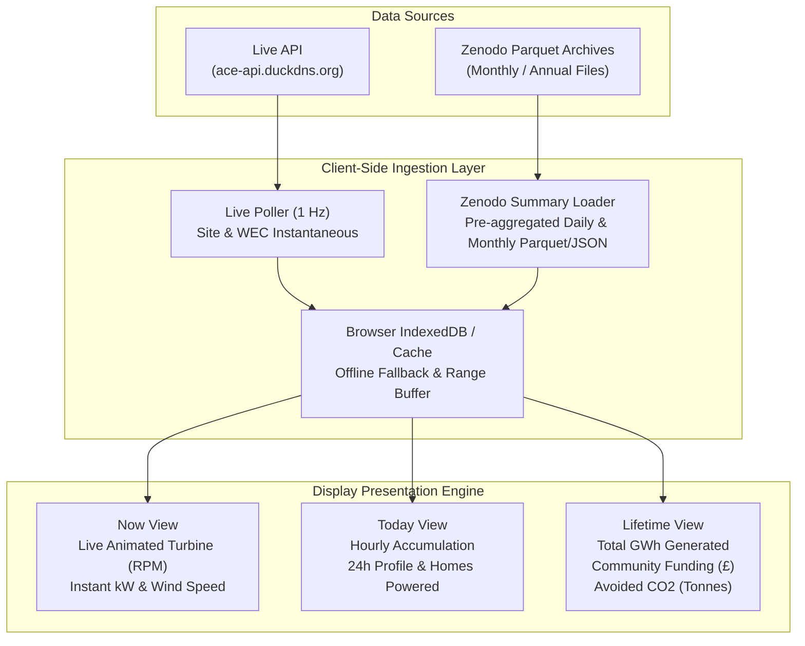

# ACE Wind Turbine Data - Data Sources & Integration Guide

This document specifies the dual data pipeline architecture powering the ACE Wind Turbine public display: the **Live ACE API** for real-time telemetry and the **Zenodo Open Archive** for multi-year historical datasets.

---

## 1. Live ACE API Pipeline

The live API runs a high-performance FastAPI service hosted at `https://ace-api.duckdns.org` that ingests telemetry directly from the on-site Enercon SCADA / OPC UA plant network.

### 1.1 Live Data Retention & Windows
The API stores rolling operational windows in a high-speed database with automated retention tiers:

| Stream / Resolution | Retention Period | Expected Interval | Typical Application |
| :--- | :--- | :--- | :--- |
| **`1s` (Instantaneous)** | **35 days** | 1 second (1 Hz) | Real-time animated turbine, live power gauge, blade RPM, instant wind speed. |
| **`60s` (One-minute)** | **90 days** | 60 seconds | 24-hour high-resolution trend charts, power fluctuations, gusts. |
| **`10m` (Standard SCADA)** | **366 days (1 year)** | 600 seconds | Multi-month power curves, seasonal wind distributions, energy yields. |
| **`daily` (Daily rollup)** | **Lifetime (from commissioning)** | 86,400 seconds | Day-by-day energy production totals, availability records. |
| **`events` (Status & Setpoints)** | **Continuous / event-driven** | On change | Maintenance tracking, grid curtailment logs. |

### 1.2 Polling Architecture & Reliability Safeguards
- **Dashboard Polling Rate:** 1.0 s interval on `/v1/sites/ace/data/site_instantaneous/latest?resolution=1s`.
- **Cache Header Respect:** The API returns `Cache-Control` max-age headers matching resolution capability.
- **Failover & Reconnection:**
  - If network connection drops, fallback to client-side interpolated simulation or cached recent state.
  - Implement exponential backoff when encountering HTTP 429 or 503 responses.

---

## 2. Zenodo Historical Dataset Repository

The long-term open archive is deposited on CERN's Zenodo data repository under open access.

### 2.1 Zenodo DOIs & Metadata
- **Concept DOI (Permanent Parent):** [`10.5281/zenodo.22662372`](https://doi.org/10.5281/zenodo.22662372)
- **Latest Verified Publication:** [`10.5281/zenodo.22794387`](https://doi.org/10.5281/zenodo.22794387) (Version `2026.08_v2`)
- **Publication Frequency:** **Monthly updates** published after quality validation.
- **Licence:** [Creative Commons Attribution 4.0 International (CC-BY-4.0)](https://creativecommons.org/licenses/by/4.0/)
- **Authors / Creators:** 
  - Charlie Plumley (Calton Works)
  - Andrew Garrad (Ambition Community Energy)
  - Wilf Burke (Ambition Community Energy)
  - Christian Jonsson (KUDO)
  - Andrew Smirthwaite (KUDO)
- **Partners Acknowledged:** Community volunteers, Enercon, Calton Works, and KUDO.

---

### 2.2 Available Files in Zenodo Archive

| Filename | Format | Size | Description & Contents |
| :--- | :--- | :--- | :--- |
| `ace-wind-2026-instantaneous_1s.parquet` | Apache Parquet | ~127.7 MB | 1-second instantaneous OPC telemetry (power, wind speed, rotor RPM, electrical parameters). |
| `ace-wind-2026-instantaneous_60s.parquet`| Apache Parquet | ~17.7 MB | 60-second instantaneous OPC telemetry rolling archive. |
| `ace-wind-2026-60s.parquet` | Apache Parquet | ~50.8 MB | 60-second SCADA logs (`wecstd`, temperatures, electrical stats). |
| `ace-wind-2026-10m.parquet` | Apache Parquet | ~5.38 MB | Standard 10-minute SCADA logs per IEC 61400-25. Benchmark for wind analysis. |
| `ace-wind-2026-daily.parquet` | Apache Parquet | ~311 KB | Daily operational aggregates, availability, and fiscal generation totals. |
| `ace-wind-2026-configuration.parquet` | Apache Parquet | ~195 KB | Full chronological history of turbine and controller parameter settings. |
| `ace-wind-2026-events.parquet` | Apache Parquet | ~294 KB | Complete event log of turbine status codes, warning flags, and grid setpoints. |
| `ACE wind turbine.kmz` | Google Earth KMZ | ~19.4 KB | Geographic placemark, coordinates, hub elevation, and 3D turbine spatial model. |

---

## 3. Data Integration Strategy for the Public Display

### 3.1 Seamless Blend of Live + Historical
1. **Live Stream:** The display maintains a rolling in-memory buffer of the last 60 minutes of 1-second and 60-second data fetched directly from `GET /v1/sites/ace/data/site_instantaneous/latest`.
2. **Historical Context:** Pre-aggregated daily and monthly summaries derived from the Zenodo dataset provide immediate baseline comparisons (e.g. *"Today's wind is 35% higher than the August average"* or *"Total lifetime clean electricity generated: 30.6 GWh"*).
3. **Graceful Offline Degradation:** If internet connectivity to `ace-api.duckdns.org` is temporarily disrupted, the display transitions to an ambient simulation mode based on historical averages and informs the screen administrator with an unobtrusive status pill.

---

## 4. Citation & Attribution Requirements

All applications, codebases, displays, and academic derivatives must retain the following attribution statement:

> **Attribution:**  
> *Plumley, Charlie; Garrad, Andrew; Burke, Wilf; Jonsson, Christian; Smirthwaite, Andrew. ACE Wind Turbine Data. Zenodo. https://doi.org/10.5281/zenodo.22662372*  
> Published by Ambition Community Energy (ACE) under [CC-BY-4.0](https://creativecommons.org/licenses/by/4.0/).
