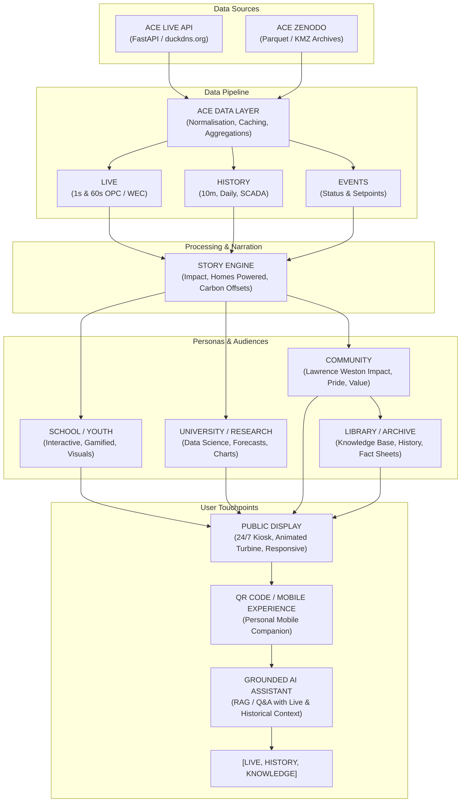

# ACE Wind Turbine Public Display - Master Project Overview

## 1. Background & Context

### Ambition Community Energy (ACE)
[Ambition Community Energy (ACE)](https://ambitioncommunityenergy.org/) is a community interest company (CIC) established by the residents of Lawrence Weston, Bristol, UK. ACE was created through their resident-led, open-membership regeneration charity, [Ambition Lawrence Weston (ALW)](https://www.ambitionlw.org/).

### The Wind Turbine
ACE was created to build and operate a **4.2 MW onshore wind turbine** situated in Avonmouth/Lawrence Weston, Bristol. 
- **Capacity:** 4.2 MW (nominal power 4,245 kW)
- **Model:** Enercon E-115 EP3 (WEC Type EP3-CS02)
- **Dimensions:** Hub height 150 meters (490 ft), rotor diameter 115.7 meters (380 ft), tip height ~207.8 meters — the tallest onshore wind turbine in England.
- **Commissioned:** Spring 2023 (operational data begins March 29, 2023).
- **Mission:** Its sole purpose is to generate clean energy and long-term income to support ALW's work tackling deprivation, fuel poverty, and inequality in Lawrence Weston.

### Open Data Mission
ACE is releasing data from its wind turbine openly under a [Creative Commons Attribution 4.0 International (CC-BY-4.0)](https://creativecommons.org/licenses/by/4.0/legalcode) licence to:
1. **Increase Visibility:** Enhance awareness and pride in the ACE wind turbine, particularly within the Lawrence Weston community that owns it.
2. **STEM & Youth Inspiration:** Encourage local students, youth, and residents to take an active interest in renewable energy and sustainability.
3. **Research & Innovation:** Provide open live and historical data access to universities, researchers, and data scientists, including for developing new techniques such as short-term wind-power forecasting and grid integration analysis.

---

## 2. The Challenge

### Challenge Objective
ACE seeks to create an engaging public-facing display for the local community centre (Ambition Lawrence Weston Community Centre) that raises awareness of the wind turbine and effectively communicates the economic, environmental, and social value it delivers to the Lawrence Weston community.

### Challenge Scope
Participants are tasked with building a dashboard, interactive display, digital twin, data artwork, or creative visual experience for continuous display on a screen in the community centre.

The solution must:
- Use live data from the ACE wind turbine via the [ACE Live API](https://ace-api.duckdns.org/docs).
- Translate raw telemetry into engaging, human-centric narratives for a non-technical public audience.
- Highlight community value (e.g. homes powered, fuel poverty funds generated, CO₂ saved, local community projects funded).
- Operate reliably 24/7 with minimal or zero maintenance.
- Be published under an appropriate open licence with complete reproduction steps.

The winning solution will be publicly displayed and made accessible alongside, or potentially as a replacement for, the current integrated [ACE Dashboard](https://ace-api.duckdns.org/dashboard/), subject to technical review.

---

## 3. Evaluation Criteria & Awards

### Judging Criteria
1. **Public Accessibility:** Is the display easy to understand, inviting, and engaging for members of the public with little or no technical knowledge of wind energy?
2. **Effective Use of Live Data:** Does the solution make meaningful, accurate use of live ACE turbine telemetry and help visitors understand current operations?
3. **Community Relevance:** Does it clearly communicate the value and direct benefits of the turbine to Lawrence Weston and its residents?
4. **Creativity & Engagement:** Does the solution present data in a memorable, innovative, or visually stunning way?
5. **Practicality & Robustness:** Is the solution suitable for continuous 24/7 display on a public screen in a community centre with minimal intervention?

### Submission, Presentation & Prizes
- **Submission Task:** Submissions are posted in the WeDoWind platform task "[Solutions](https://community.wedowind.ch/posts/open-data-exploration-solutions-107654528)" with URL, description, and screenshots.
- **Presentation Call:** Wednesday 28 October — Live pitch and demonstration followed by an open public vote.
- **Prizes:**
  1. **Overall Winner:** Determined by open public vote.
  2. **Judge's Award:** Presented by Charlie Plumley based on the criteria above.
  3. **Community Contribution Award:** Recognising positive peer engagement and community support.

---

## 4. System Architecture Diagram

---

## 5. Final Go-Live Package (20 Deliverables)

The project roadmap culminates in 20 comprehensive deliverables:

1. **Production public display:** High-impact, responsive, high-aesthetic kiosk interface.
2. **ACE live API integration:** Real-time ingestion of instantaneous site and WEC signals.
3. **Zenodo historical data integration:** Pipeline connecting to Zenodo Parquet historical datasets.
4. **Local data/analytics layer:** High-performance caching, interpolation, and statistical metrics.
5. **Animated turbine:** Real-time synchronized 2D/3D/SVG turbine spinning at actual RPM with blade pitch and yaw.
6. **Now / Today / Lifetime:** Triple-horizon view of instantaneous power, daily generation, and lifetime impact.
7. **Historical Explorer:** Interactive temporal charts (1s, 60s, 10m, daily) comparing wind vs. power output.
8. **Community Impact experience:** Real-world metrics for Lawrence Weston (homes powered, fuel vouchers, community funds).
9. **Educational experience:** Interactive explainer for schools and students on how wind turbines work.
10. **University / Data Science experience:** Power curve analysis, coefficient of performance, telemetry inspection.
11. **Audience configuration:** Mode switcher tailored for Public/Community, Schools, and Data Science.
12. **Interactive scenes:** Engaging visual themes (day/night, stormy weather, Bristol skyline, digital twin).
13. **QR / mobile experience:** Mobile-friendly companion accessible via on-screen QR codes.
14. **Grounded AI assistant:** Context-aware interactive assistant grounded in live telemetry and ACE facts.
15. **Environmental calculations:** Real-time avoided CO₂, equivalent trees planted, and grid displacement metrics.
16. **Kiosk / 24x7 operation:** Fullscreen kiosk mode, auto-recovery, sleep scheduling, error handling.
17. **Automated data update process:** Background polling, websocket/SSE fallback, retry-after backoff.
18. **Open-source repository:** Clean, modular, well-commented repository under open license.
19. **Complete documentation:** Thorough user, developer, and maintenance manuals.
20. **Deployment instructions:** One-click and step-by-step instructions for community centre kiosk hardware.

---

## 6. Curated Directory of Linked Websites & Resources

| Entity / Resource | URL | Description / Role |
| :--- | :--- | :--- |
| **Ambition Community Energy (ACE)** | [ambitioncommunityenergy.org](https://ambitioncommunityenergy.org/) | Official website of the community interest company operating the turbine. |
| **Ambition Lawrence Weston (ALW)** | [ambitionlw.org](https://ambitionlw.org/) | Resident-led community charity receiving surplus turbine revenue to tackle deprivation. |
| **ACE Live API Docs** | [ace-api.duckdns.org/docs](https://ace-api.duckdns.org/docs) | Interactive Swagger UI documentation for live and range telemetry endpoints. |
| **ACE Live API OpenAPI JSON** | [ace-api.duckdns.org/openapi.json](https://ace-api.duckdns.org/openapi.json) | Complete OpenAPI 3.1.0 specification for automated clients. |
| **ACE Live Dashboard** | [ace-api.duckdns.org/dashboard](https://ace-api.duckdns.org/dashboard/) | Existing operational dashboard for ACE wind turbine. |
| **ACE API Landing Page** | [ace-api.duckdns.org/index.html](https://ace-api.duckdns.org/index.html) | Human-readable index and landing page for the API. |
| **ACE API LLM Guide** | [ace-api.duckdns.org/llms.txt](https://ace-api.duckdns.org/llms.txt) | LLM and AI agent guidelines for query practices and citation. |
| **Zenodo Concept Record** | [doi.org/10.5281/zenodo.22662372](https://doi.org/10.5281/zenodo.22662372) | Persistent concept DOI for the complete ACE historical dataset. |
| **Zenodo Latest Release (2026.08_v2)** | [doi.org/10.5281/zenodo.22794387](https://doi.org/10.5281/zenodo.22794387) | Specific verified release containing monthly Parquet and KMZ archives. |
| **WeDoWind Challenge Solutions Task** | [community.wedowind.ch/posts/open-data-exploration-solutions-107654528](https://community.wedowind.ch/posts/open-data-exploration-solutions-107654528) | Official challenge submission thread for participants. |
| **WeDoWind Platform** | [wedowind.ch](https://www.wedowind.ch/) | Collaborative wind energy data challenges and ecosystem hub. |
| **Charlie Plumley (ODE Lead)** | [linkedin.com/in/charlie-plumley](https://www.linkedin.com/in/charlie-plumley) | Challenge coordinator, Calton Works lead, and creator of the open dataset. |
| **Creative Commons CC-BY-4.0** | [creativecommons.org/licenses/by/4.0/legalcode](https://creativecommons.org/licenses/by/4.0/legalcode) | Open data license governing usage, remixing, and distribution. |
| **Google Earth Pro** | [google.com/earth/versions](https://www.google.com/intl/en-GB/earth/versions/#earth-pro) | Tool for viewing the turbine KMZ geographic model. |
