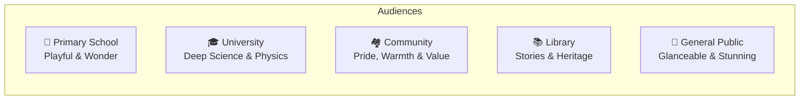
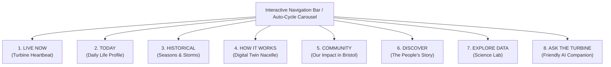
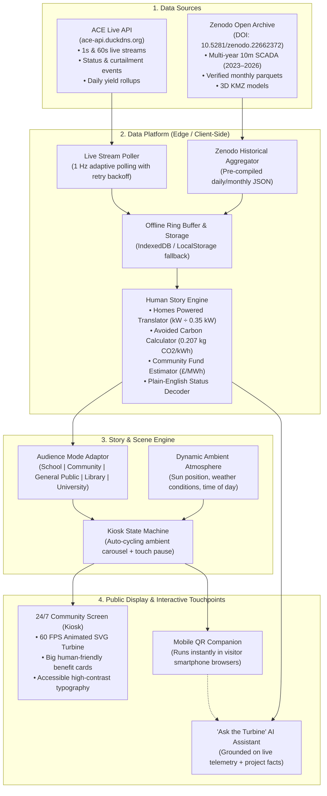

# ACE Wind Turbine Public Display - Experience & Storytelling Blueprint

> **Design Philosophy: "Every Number Tells a Human Story"**  
> Visitors to the Ambition Lawrence Weston (ALW) Community Centre will not see confusing engineering telemetry. Instead, every kilowatt and wind gust is translated into vivid, relatable real-world benefits: warm living rooms, boiled kettles, protected nature, and money reinvested into local families.

---

## 1. The Human-Centric Translation Rulebook

To make the turbine's impact instantly clear, the display replaces technical jargon with friendly, visual copy:

| Raw SCADA Parameter | ❌ What We DON'T Show (Too Technical) | ✅ What the Public Sees on Screen | 🎨 Mental Picture / Visual Benefit |
| :--- | :--- | :--- | :--- |
| `wec_active_power = 3800 kW` | "Generator Active Power: 3.8 MW" | **"Powering 3,600 homes in Lawrence Weston right now!"** | A neighborhood map with rows of cozy houses lighting up in warm gold. |
| `wec_wind_speed = 9.2 m/s` | "Anemometer Wind Velocity: 9.2 m/s" | **"A brisk Severn breeze is passing through!"** | Animated leaves and smooth wind ribbons flowing past the turbine blades. |
| `wec_rotor_speed = 11.4 rpm` | "Rotor Frequency: 0.19 Hz / 11.4 RPM" | **"Blade tips are flying at 165 mph — faster than an express train!"** | An animated speed badge comparing blade tips to a high-speed train or cheetah. |
| `energy_produced = 42,000 kWh` (Today) | "Daily Aggregated Yield: 42.0 MWh" | **"Today we made enough clean electricity to brew 1.4 million cups of tea!"** | A steaming mug counter or a boiling kettle graphic. |
| Avoided Carbon (`0.207 kg CO₂/kWh`) | "Displaced CO₂e: 8.7 Tonnes" | **"We kept 8.7 tonnes of dirty smoke out of our Bristol air today!"** | A vibrant green mini-forest graphic showing trees breathing clean air. |
| Community Fund Revenue | "Fiscal Surplus Accrual: £3,400" | **"£3,400 earned today for local winter fuel grants and community clubs!"** | A glowing community piggy bank unlocking warm meals and heated community rooms. |
| `status.main_status = 1` (Paused) | "Status Code 1: Idle / Below Cut-in" | **"Resting peacefully: waiting for the next gust of wind to wake it up."** | A gentle sleeping breeze icon; friendly and reassuring. |
| Curtailment Setpoint Active | "DNO Export Curtailment Order Active" | **"The National Grid is completely full of clean energy right now! The turbine is taking a polite breather."** | A cheerful power grid battery showing "100% Full". |

---

## 2. Audience Experience Profiles

### 1. 🎒 Primary School (Ages 5–11)
* **Voice & Tone:** Curious, cheerful, encouraging, full of wonder.
* **On-Screen Narrative:**
  > *"Meet England's tallest wind turbine! Did you know its blades are taller than 45 double-decker buses stacked together? When the wind blows, it captures clean sky energy and turns on the lights in your school and bedroom!"*
* **How They Visualize It:**
  * Interactive comparison slider: Turbine height vs. Big Ben vs. dinosaur vs. London Eye.
  * Cartoon wind character blowing animated swirls that spin the giant blades faster when you tap the screen.
  * Gamified mission: *"Can you blow into the screen to help power the library?"*

### 2. 🏘️ Lawrence Weston Community
* **Voice & Tone:** Proud, transparent, caring, neighborly.
* **On-Screen Narrative:**
  > *"Owned 100% by us, for us. Every single gust of Avonmouth wind generates clean power that funds our community centre, fuels emergency heating vouchers for local families, and creates youth jobs in Lawrence Weston."*
* **How They Visualize It:**
  * **"Our Village Powered"**: A 3D illustration of Lawrence Weston where streets (Long Cross, Ridingleaze, Broadbury Road) light up dynamically as power generation climbs.
  * **Community Fund Counter**: A clear counter showing total pounds (£) directed toward tackling local fuel poverty this season.

### 3. 🚶 General Public & Casual Passers-By
* **Voice & Tone:** Ambient, visually breathtaking, glanceable in 5 seconds.
* **On-Screen Narrative:**
  > *"Bristol's Giant Clean Machine is spinning at 12 RPM right now, powering 3,400 homes across the city."*
* **How They Visualize It:**
  * Ultra-smooth 60 FPS animated turbine floating against a sky background that matches the real outside weather (sunny blue, rainy clouds, orange sunset, or starry night).
  * Two giant bold metrics: **Homes Powered Right Now** and **Today's Clean Energy**.

### 4. 📚 Library & Local Archive
* **Voice & Tone:** Informative, narrative, respectful of community heritage.
* **On-Screen Narrative:**
  > *"From a bold dream by local residents in 2014 to the tallest onshore turbine in England. Explore how Lawrence Weston residents overcame every obstacle to build a 4.2 MW giant."*
* **How They Visualize It:**
  * Photographic journey: Construction milestones, giant blade convoys crawling through Avonmouth docks, and ground-breaking celebrations.
  * Complete interactive fact cards explaining the engineering behind gearless direct-drive turbines.

### 5. 🎓 University & STEM Explorers
* **Voice & Tone:** Precise, scientific, data-rich (with a one-click technical mode switch).
* **On-Screen Narrative:**
  > *"Enercon E-115 EP3 4.2 MW synchronous annular generator. Direct-drive gearless topology with full 4-quadrant IGBT frequency converter."*
* **How They Visualize It:**
  * Interactive IEC 61400-25 power curve ($P\text{ vs }V_{wind}$) scatter plots.
  * Live blade pitch angle dynamics ($\theta$), reactive power factor ($\cos\phi$), and open access Zenodo dataset download links.

---

## 3. Initial Scene Map (8 Screen Experiences)

---

### Scene 1: LIVE NOW (The Turbine's Living Heartbeat)
* **What Visitors See:**
  * A full-height animated turbine spinning smoothly in real time, matching the exact speed of the blades outside.
  * Ambient wind gusts represented by glowing wind particles flowing across the screen.
* **Friendly On-Screen Text:**
  * **Headline:** *"Right Now at Avonmouth..."*
  * **Hero Metric:** *"**3,420 Homes** Powered This Second"*
  * **Sub-Cards:**
    * *"Wind Speed: 8.5 m/s (A lovely, fresh sailing breeze)"*
    * *"Spin Speed: 11.2 turns a minute (Tip speed: 155 mph!)"*
    * *"Grid Status: Exporting 3,650 kW of 100% green electricity"*
* **Visual Benefit:** Visitors immediately understand: *The turbine is spinning, and it's powering our homes right this minute.*

---

### Scene 2: TODAY (A Day in the Life)
* **What Visitors See:**
  * A smooth wave chart showing the day's generation from midnight to the present minute.
  * A sun/moon path across the top of the chart indicating day and night.
* **Friendly On-Screen Text:**
  * **Headline:** *"What Our Giant Did Today"*
  * **Highlight:** *"Since midnight, the wind has given us **48,200 kWh** of clean power!"*
  * **Relatable Milestones:**
    * *"⚡ Enough electricity to brew **1.6 million cups of tea**"*
    * *"🚗 Kept **12.4 tonnes of carbon fumes** out of the atmosphere"*
    * *"🍳 Powered breakfast cooking for **4,000 Bristol families**"*
* **Visual Benefit:** Visualizing how invisible wind turns into daily morning breakfasts, warm showers, and boiled kettles.

---

### Scene 3: HISTORICAL (Seasons & Historic Storms)
* **What Visitors See:**
  * Month-by-month clean energy production bars spanning from spring 2023 to today.
  * Record badges for the windiest storm days in recent UK history.
* **Friendly On-Screen Text:**
  * **Headline:** *"Seasons in the Wind"*
  * **Key Insight:** *"Winter is our power season! When cold Atlantic gales sweep across the Severn, our turbine works hardest."*
  * **Storm Hall of Fame:**
    * *"Storm Isha (Jan 2024): Produced a record 94,000 kWh in a single 24-hour gale!"*
    * *"Storm Ciarán: Gusts reached 58 mph, safely handled by automated storm-control blades."*
* **Visual Benefit:** Highlights that windy, stormy winter weather is actually a blessing for community energy.

---

### Scene 4: HOW IT WORKS (Inside the Giant - Digital Twin)
* **What Visitors See:**
  * A transparent 3D cutaway of the turbine nacelle 150m up in the sky.
  * Gentle pulses showing electricity flowing from the turning blades through the generator down the tower to the ground.
* **Friendly On-Screen Text:**
  * **Headline:** *"Look Inside England's Tallest Wind Turbine"*
  * **Interactive Hotspots:**
    * **The Blades:** *"Aerodynamically sculpted wings that turn wind into rotation without burning a drop of fuel."*
    * **The Direct-Drive Generator:** *"No noisy gears! A giant magnetic ring creates electricity smoothly and silently."*
    * **The Liquid Cooler:** *"Running at a cool 42°C today to keep the electronics happy."*
    * **The 150m Tower:** *"Strong concrete and steel anchored deep in the Severn estuary bedrock."*
* **Visual Benefit:** Demystifies the machine. Kids and adults see that it's safe, clean, high-tech, and quiet.

---

### Scene 5: COMMUNITY (The Lawrence Weston Impact Hub)
* **What Visitors See:**
  * An interactive map of the local neighborhood and community centre.
  * Three glowing benefit pillars: **Fuel Support**, **Local Youth**, and **Community Hubs**.
* **Friendly On-Screen Text:**
  * **Headline:** *"Powered by Lawrence Weston, For Lawrence Weston"*
  * **Impact Stories:**
    * **Tackling Fuel Poverty:** *"Surplus revenue directly funds emergency warm packs and winter electricity vouchers for local elders."*
    * **Our Community Centre:** *"Electricity and heating for this very room is funded by our turbine."*
    * **Skills & Youth:** *"Inspiring local students through STEM tours and green apprenticeship grants."*
* **Visual Benefit:** Connects the steel and blades on the horizon directly to warmth, social care, and local neighborhood pride.

---

### Scene 6: DISCOVER (The Resident-Led Journey)
* **What Visitors See:**
  * A scrollable visual timeline from 2014 to 2023+.
  * Historical photos of community meetings, fundraising, and the giant turbine blades arriving at the Bristol Port.
* **Friendly On-Screen Text:**
  * **Headline:** *"How Our Community Built a Giant"*
  * **Timeline Highlights:**
    * **2014:** *"Residents gather at ALW: 'Can we build our own clean power station?'"*
    * **2019:** *"Planning permission granted after years of hard community volunteering."*
    * **2022:** *"The 57-meter blades travel through Avonmouth streets under police escort!"*
    * **March 29, 2023:** *"First export to the National Grid! 100% community-owned."*
* **Visual Benefit:** Inspires visitors by proving that ordinary local residents can take on giant green energy projects and succeed.

---

### Scene 7: EXPLORE DATA (The STEM & University Lab)
* **What Visitors See:**
  * High-resolution charts, power curve overlays, and real-time scatter plots.
  * A prominent button: **"Download Open Data (CSV / Parquet)"** and citation details.
* **Friendly On-Screen Text:**
  * **Headline:** *"The Open Science Laboratory"*
  * **Accessible Explanation:** *"We believe in open science. Researchers around the globe use our live data to invent better renewable energy technology."*
  * **Scientific Panel:** Real-time power coefficient ($C_p$), turbine availability ($98.7\%$), and grid frequency ($50.02\text{ Hz}$).
* **Visual Benefit:** Bridges casual community curiosity with real, open-access university research.

---

### Scene 8: ASK THE TURBINE (Friendly AI Companion)
* **What Visitors See:**
  * An animated chat speech bubble with friendly preset conversation cards.
  * A prominent QR code: *"Scan to chat with the turbine on your mobile phone while you walk around!"*
* **Friendly Suggested Questions & Live Answers:**
  * *Q: "Are you spinning right now?"*  
    *A: "Yes! I'm turning at 10.8 rpm right now in an 8 m/s breeze, sending 3,200 kW across Bristol."*
  * *Q: "Why did you stop earlier today?"*  
    *A: "The wind briefly dipped below 2.5 m/s around 2 PM, so I took a short rest to wait for the next breeze!"*
  * *Q: "How tall are you?"*  
    *A: "My tip reaches 207.8 meters — taller than the London Eye and Blackpool Tower!"*
* **Visual Benefit:** Allows anyone of any age to satisfy their curiosity naturally without navigating complex menus.

---

## 4. End-to-End System Architecture

---

## 5. Execution Roadmap

| Milestone | Deliverable | Focus & Human Story Integration |
| :--- | :--- | :--- |
| **Milestone 1** | **Telemetry Connector & Story Engine** | Implement polling against `https://ace-api.duckdns.org` and embed the formulas for homes powered, kettles boiled, and avoided emissions. |
| **Milestone 2** | **Animated Turbine & "Live Now" Scene** | Build the 60 FPS SVG/Canvas animated turbine that spins smoothly in real-time, surrounded by dynamic breeze particles and warm community stat cards. |
| **Milestone 3** | **"Today" & "Community" Benefit Scenes** | Create the glowing Lawrence Weston neighborhood map and the daily tea/kettle/home milestone visualizers. |
| **Milestone 4** | **"How It Works" & "Historical" Scenes** | Build the interactive 3D/transparent nacelle cutaway with live temperatures and the seasonal Storm Hall of Fame. |
| **Milestone 5** | **"Ask the Turbine" & Mobile QR Mode** | Add conversational AI grounded on live data, mobile phone QR responsiveness, and 24/7 kiosk reliability features (auto-reload, offline resilience). |
