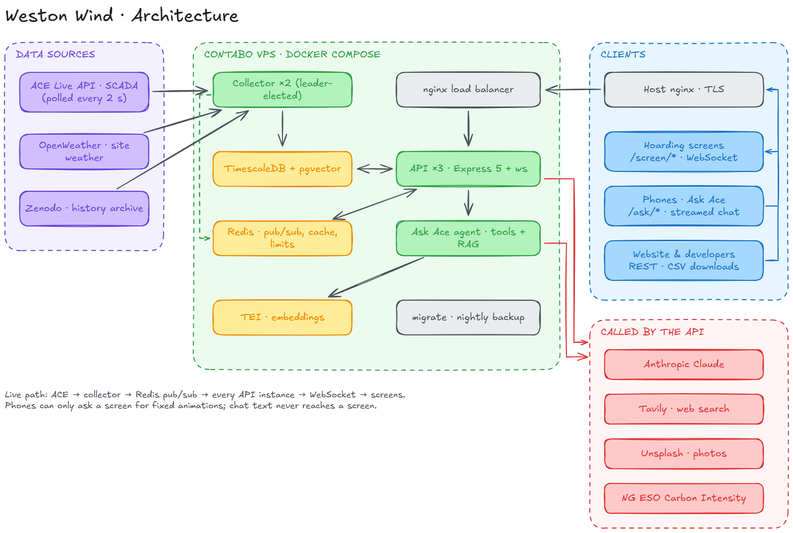
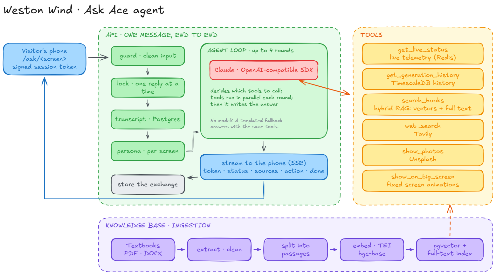
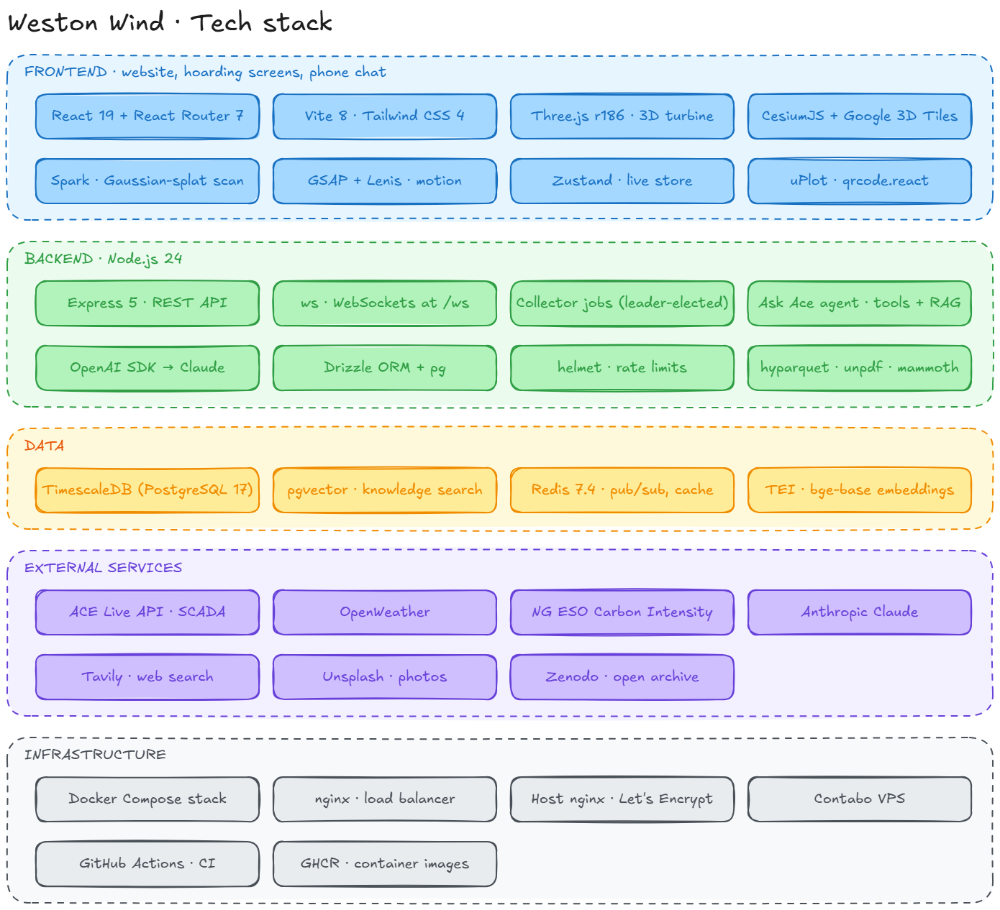

# Lawrence Weston wind

**Live wind. Local energy. A turbine you can talk to.**

Lawrence Weston wind is the public display platform for the ACE community wind turbine in Lawrence Weston, Bristol: an Enercon E-115 EP3 (4.2 MW) owned by its community through Ambition Community Energy. It turns the turbine's live telemetry into storytelling screens for public hoardings, a private phone chat that answers questions about the turbine, a public website, and a developer portal with open data.

The platform is built on the turbine's open data: the [ACE Live API](https://ace-api.duckdns.org/docs) and the [ACE Wind Turbine Data archive on Zenodo](https://doi.org/10.5281/zenodo.22662372).

## Contents

- [Features](#features)
- [Architecture](#architecture)
- [The Ask Ace agent](#the-ask-ace-agent)
- [Tech stack](#tech-stack)
- [System requirements](#system-requirements)
- [Getting started](#getting-started)
- [Configuration](#configuration)
- [Contributing and secret safety](#contributing-and-secret-safety)
- [Scripts](#scripts)
- [API](#api)
- [Deployment](#deployment)
- [Homes-equivalent calculation](#homes-equivalent-calculation)
- [Project structure](#project-structure)
- [Data and attribution](#data-and-attribution)

## Features

| Route | What it is |
| --- | --- |
| `/` | Website: live figures, how the turbine works, the screens and the story of the project |
| `/screen/students` | Hoarding screen for children: a cartoon guide, height and speed comparisons, the energy journey, the build story on a climb up the tower, the town that owns it |
| `/screen/community` | Hoarding screen for residents: the turbine over the real Lawrence Weston scan, the live real-world view, where the power goes and what it means locally |
| `/screen/college` | Hoarding screen for students of engineering and data: specification, power curve, X-ray climb through the machine, the energy path to the grid |
| `/screen/story` | "Follow the Energy": a continuous journey from the wind to a home |
| `/screen/live` | Live explorer: the turbine at its real coordinates, inspectable room by room |
| `/ask/:screen` | Ask Ace: a private phone chat opened from each screen's QR code, no login |
| `/developers` | Developer portal: endpoint explorer, code samples, how to connect to the screens, instant CSV downloads |

Highlights:

- **Live, not looped.** The 3D rotor turns at the rpm the turbine reports and the nacelle follows the live bearing. Captions, panels and charts are filled from live data, steadied so figures drift rather than flicker.
- **Real place, real time.** The sun sits where it really is over Bristol, and cloud, rain and haze follow the weather at the site.
- **Phones in the loop.** Scanning a screen's QR code opens a chat that belongs to that screen. A visitor can ask the screen to play one of a fixed set of animations; nothing a visitor types is ever shown on a screen.
- **Built for kiosks.** Screens run unattended, recover their connection on their own, go full screen on the first interaction, and keep GPU use low (shaders compiled in parallel up front, a capped frame rate and pixel ratio).
- **Open data.** Every dataset can be downloaded as CSV for any date range, without signing up.

## Architecture



- **Collectors** poll the ACE Live API, the weather and the Zenodo archive. Two run for resilience; a leader election ensures only one is active. Readings are stored in TimescaleDB and published to Redis.
- **API instances** (three, behind an nginx load balancer) serve the REST API, push live state to every connected screen over WebSockets, stream the chat over Server-Sent Events, and stream CSV exports.
- **Redis** carries live readings and screen commands between instances, and holds caches, rate limits and locks.
- **TimescaleDB** stores the telemetry history and, with pgvector, the knowledge base the chat searches.

The live path: ACE → collector → Redis pub/sub → every API instance → WebSocket → screens.

## The Ask Ace agent



Each message is cleaned, locked (one reply at a time per session, so the transcript stays in order) and answered with the visitor's screen persona. The agent runs up to four rounds; in each, the model can call several tools in parallel:

| Tool | Source |
| --- | --- |
| `get_live_status` | Live telemetry |
| `get_generation_history` | Stored history and records |
| `search_books` | Hybrid retrieval over the knowledge base: vector and full-text search merged with reciprocal-rank fusion |
| `web_search` | Tavily |
| `show_photos` | Unsplash, with photographer credits |
| `show_on_big_screen` | A fixed animation on the visitor's screen |

The answer streams to the phone as Server-Sent Events (`token`, `status`, `sources`, `action`, `done`) and the exchange is stored with its steps. Sessions are anonymous: the server mints a random id and signs it, so a session cannot be guessed or forged. Without a configured language model, a templated fallback answers using the same tools.

The knowledge base is built from documents in `ingestion/`: text is extracted and cleaned, split into passages, embedded with a local text-embeddings server and stored with a full-text index.

## Tech stack



The database is PostgreSQL 17 with the TimescaleDB and pgvector extensions (the `timescale/timescaledb-ha:pg17` image). Redis 7.4 handles pub/sub, caches and rate limits. The knowledge base uses a local CPU text-embeddings service. Grafana is not included in either Compose stack or provisioned by this repository; it is not required to run the project.

## System requirements

- **Local development:** Node.js 24, npm, Docker Engine and Docker Compose. The development Compose file starts PostgreSQL/TimescaleDB, Redis and the CPU embeddings service; the API and Vite website run on the host.
- **Production host:** A Linux server with Docker Engine and Docker Compose, persistent storage for the Compose volumes (especially `db_data` and `db_backups`), and a host reverse proxy with TLS. The included deployment uses a Contabo server at `/opt/weston-wind`, with host nginx proxying to the Compose load balancer on `127.0.0.1:4100`; the public site needs DNS and HTTPS. The deploy workflow connects by SSH and pulls the application image from GitHub Container Registry.
- **Sizing:** No Contabo VPS plan, CPU/RAM minimum or disk capacity is specified in this repository. Size the host for PostgreSQL, Redis, the CPU embedding model, two collectors, three API instances, nginx and backups; measure memory and disk use for your data retention and traffic before relying on a particular plan. The frontend also needs a browser capable of WebGL for its 3D views.


## Getting started

### Prerequisites

- Node.js 24
- Docker, for the local database, Redis and embeddings services

### Run locally

```bash
git clone https://github.com/klardatalabs/ace_wind_display.git
cd ace_wind_display

npm run setup                                # server and frontend dependencies
cp .env.example .env                         # then fill in the values you need
docker compose -f compose.dev.yaml up -d     # TimescaleDB, Redis, embeddings

npm run dev                                  # migrations, collector and API on :4100
npm run dev:web                              # the website with hot reload on :5173
```

Open `http://localhost:5173`. The Vite dev server proxies `/api` and `/ws` to the API.

To serve the production build from the API instead:

```bash
npm run build
npm start                                    # http://localhost:4100
```

### Knowledge base

Place PDF or DOCX documents in `ingestion/`, then:

```bash
npm run knowledge -- ingest                  # extract, split, embed and store
npm run knowledge -- search "how does pitch control limit power"
```

## Configuration

All configuration is read from environment variables; `.env.example` lists the settings needed for common setups. In production the API refuses to start without the required values.

| Variable | Purpose |
| --- | --- |
| `PUBLIC_ORIGIN` | Public origin of the site, used in the screens' QR codes (required in production) |
| `PGHOST`, `PGPORT`, `PGUSER`, `PGPASSWORD`, `PGDATABASE` | TimescaleDB connection |
| `REDIS_URL` / `REDIS_PASSWORD` | Redis connection |
| `CHAT_SESSION_SECRET` | Signs chat session tokens (required in production) |
| `ANTHROPIC_API_KEY` | Claude through Anthropic's OpenAI-compatible endpoint |
| `LLM_BASE_URL`, `LLM_API_KEY`, `LLM_MODEL` | Any other OpenAI-compatible model endpoint |
| `EMBEDDING_BASE_URL`, `EMBEDDING_MODEL` | Embeddings server for the knowledge base |
| `OPENWEATHER_API_KEY` | Weather at the site |
| `TAVILY_API_KEY` | Web search in the chat (optional) |
| `UNSPLASH_ACCESS_KEY` | Photos in the chat (optional) |
| `VITE_CESIUM_ION_TOKEN` / `VITE_GOOGLE_MAP_TILES_API_KEY` | Real-world 3D view, built into the website |

`VITE_*` values are public once built into the website: restrict those keys to your site's origins in the provider's console.

## Contributing and secret safety

This repository is private, so ask a maintainer for access before cloning. Start from a new branch, follow [Run locally](#run-locally), then run `npm test`, `node --test "frontend/src/**/*.test.mjs"`, and `npm run build` before opening a pull request. Database-backed tests need the development Compose services running. Describe what changed and how you checked it in the pull request.

Copy `.env.example` to `.env` for local work. The example's `devpass` and `devredis` values match only the localhost-bound development containers; replace them on any shared or production host. API keys for chat, weather, search, and photos are optional for local development. Leave their example fields blank until you need those features. Never commit `.env`, a filled-in example file, a private key, or credentials in source, screenshots, logs, issues, or pull requests. The ignore rules cover common secret files, but check `git diff --cached` before every commit.

If a real key is ever pushed, revoke or rotate it immediately. Removing it in a later commit does not remove it from Git history. Coordinate any history cleanup with maintainers and other clones; see [GitHub's sensitive-data removal guide](https://docs.github.com/en/authentication/keeping-your-account-and-data-secure/removing-sensitive-data-from-a-repository). Ask a repository administrator to enable [secret scanning and push protection](https://docs.github.com/en/code-security/how-tos/secure-your-secrets/prevent-future-leaks/enable-push-protection) to block supported credentials before they reach GitHub.

## Scripts

| Command | What it does |
| --- | --- |
| `npm run setup` | Install server and frontend dependencies |
| `npm run dev` | Migrations, collector and one API instance in a single process, restarting on change |
| `npm run dev:web` | Vite dev server for the website |
| `npm run build` | Build the website into `frontend/dist` |
| `npm start` | Run the single-process server |
| `npm run start:api` / `npm run start:collector` | Run the API or the collector on its own, as in production |
| `npm run db:migrate` | Apply database migrations |
| `npm run knowledge` | Manage the knowledge base (`ingest`, `list`, `remove`, `search`) |
| `npm run knowledge:eval` | Evaluate retrieval quality |
| `npm test` | Server tests |
| `npm run render:stills` | Render the website's 3D stills from the live scene |

Frontend tests run with `node --test "frontend/src/**/*.test.mjs"`.

## API

Read endpoints are open and need no key. The developer portal at `/developers` documents every endpoint with a live explorer. The main ones:

| Endpoint | Description |
| --- | --- |
| `GET /api/state` | Latest turbine snapshot |
| `WS /ws` | Live state and weather on every change; screens subscribe to receive animation commands |
| `GET /api/history/daily`, `/power-curve`, `/records`, `/compare` | History and analysis |
| `GET /api/datasets` | Open datasets and the dates each covers |
| `GET /api/datasets/{id}.csv?from=YYYY-MM-DD&to=YYYY-MM-DD` | Instant CSV download |
| `POST /api/chat/session`, `POST /api/chat/stream` | Ask Ace: a session, then a streamed reply |
| `GET /api/screens`, `POST /api/screens/command` | Connected screens, and animations a chat session can trigger |

### Connecting a display

A hoarding is a web page. Open `/screen/<name>` on any display; it goes full screen on the first interaction. For a display that should start full screen untouched, use the browser's kiosk mode:

```bash
chromium --kiosk --noerrdialogs --incognito <public-origin>/screen/community
```

## Deployment

`compose.yaml` defines the production stack: TimescaleDB, Redis, the embeddings server, a one-off migration job, two collectors, three API instances, the nginx load balancer and a backup job. Only the load balancer publishes a port, on localhost; a host web server terminates TLS in front of it (`deploy/nginx.contabo.conf` is an example).

```bash
# on the server, with a filled-in .env beside compose.yaml
docker compose up -d
```

The application image is built from the `Dockerfile`; `IMAGE` and `IMAGE_TAG` in `.env` select which one the stack runs. Continuous integration (`.github/workflows/ci.yml`) runs the server tests against a real database, builds the website and runs the frontend tests.

The Deploy workflow runs on pushes to `main`. Before using it, a maintainer must put a production `.env` on the server (never in Git) and configure these **GitHub Actions secrets** in the repository or its `production` environment under **Settings → Secrets and variables → Actions**:

| Secret | What to provide |
| --- | --- |
| `DEPLOY_HOST` | The production SSH hostname or IP address; an empty value makes the deploy fail before it copies files |
| `DEPLOY_SSH_KEY` | The private key for the account that can SSH to the production host |
| `DEPLOY_KNOWN_HOSTS` | The production host's verified SSH host-key entry; verify its fingerprint through a trusted channel before adding it |
| `VITE_CESIUM_ION_TOKEN`, `VITE_GOOGLE_MAP_TILES_API_KEY` | Optional browser-visible build tokens; restrict them to the site's origin in their provider consoles |

`GITHUB_TOKEN` is supplied by GitHub Actions; do not create or commit one for this workflow. After setting the required secrets, rerun the failed **Deploy** workflow for the desired `main` commit and check that the live page serves the new version. A successful push alone does not mean the production site updated.

## Homes-equivalent calculation

The live “homes” figure is an **illustrative demand equivalent**, not a count of homes connected to the turbine or receiving its electricity. The shared calculation uses an assumed average continuous demand of **0.35 kW per UK home** (equivalent to **8.4 kWh/day** or **3,066 kWh/year**):

```text
homes equivalent now = round(max(active turbine power in kW, 0) / 0.35 kW per home)
```

For example, 700 kW is shown as about 2,000 homes. At the configured 4,200 kW grid setpoint, it would be 12,000. The API's `homes_powered_on_average` uses the same divisor on average power from stored daily history, so it covers that stored period rather than a lifetime or annual total. This fixed demand assumption is for explanation; actual household demand varies over time.

The separate **“more than 3,000 homes each year”** figure used in some stories is Ambition Community Energy's annual project estimate. It is not calculated from the live power reading or the 0.35 kW assumption, and it should not be read as the number of homes connected to the turbine.

## Project structure

```
frontend/              React website, hoarding screens, phone chat and developer portal
  src/pages/           landing, screens, ask, developers
  src/three/           the 3D scene: turbine, world, camera, story rail, X-ray climb
  src/cesium/          the real-world 3D view
  src/content/         screen stories, build timeline, chat copy
server/
  api/                 Express app, routes, WebSocket hub, services
  collector/           scheduled jobs: live polling, history sync, weather, stories, retention
  chat/                Ask Ace: sessions, guard, personas, agent loop, tools, fallback
  knowledge/           document extraction, chunking, ingestion and hybrid search
  integrations/        ACE API, OpenWeather, Tavily, Unsplash, Zenodo, carbon intensity, LLMs
  db/                  schema, migrations and repositories
shared/                constants, physics and data definitions shared by server and website
deploy/                nginx configuration
docs/                  notes, planning and system-design/ diagrams (PNG)
assets/source/         the turbine model sources
scripts/               model export, scan preparation, renders, database backup and restore
```

## Data and attribution

Turbine data is published by Ambition Community Energy under [CC BY 4.0](https://creativecommons.org/licenses/by/4.0/). Cite it as:

> Plumley, Charlie; Garrad, Andrew; Burke, Wilf; Jonsson, Christian; Smirthwaite, Andrew. *ACE Wind Turbine Data.* Zenodo. https://doi.org/10.5281/zenodo.22662372

Weather data is from OpenWeather, regional grid data from National Grid ESO's Carbon Intensity API, and chat photographs from Unsplash, credited to their photographers. Photographs of the turbine and the community on the screens are by Ambition Community Energy.

## License and contributing

The code is open source under the [MIT License](LICENSE). The ACE turbine data it displays is published separately under CC BY 4.0 (see above) and keeps that licence. Issues and pull requests are welcome: run `npm test` before opening one.
