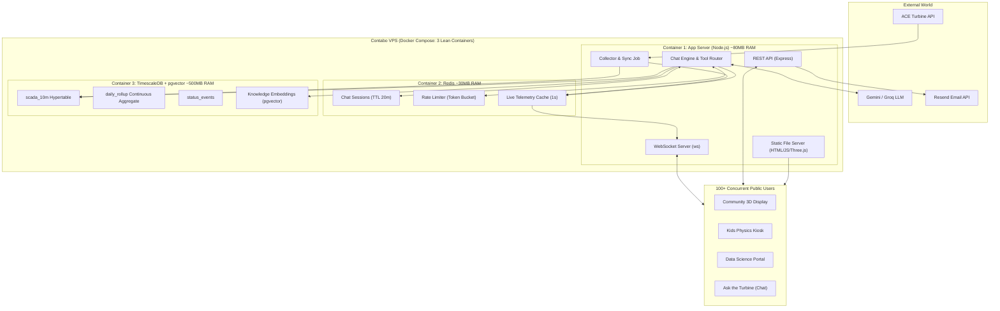

# ACE Wind Turbine Platform — Architecture Pruning & Implementation Guide

**Document Purpose:** Strict comparison between `docs/SYSTEM_DESIGN.md` and the actual repository implementation. This guide details exactly **what to keep**, **what to remove**, and **what to simplify**, ensuring high reliability on a single Contabo VPS while supporting both the live public kiosk and 100+ concurrent chatbot visitors.

---

## 1. Executive Summary: What Stays vs. What Goes

| Component / Technology | Status | Reason & Action |
| :--- | :--- | :--- |
| **Apache Kafka** | ❌ **REMOVE** | Designed for 100k+ events/sec across clusters. Our source is 1 turbine emitting 1 msg/sec (0.5 KB/s). Wastes 1.5–2 GB RAM on JVM. Users connect to WebSockets, never Kafka. |
| **S3 / MinIO Object Storage** | ❌ **REMOVE** | Total historical dataset (2023–2026) is < 25 MB. Spinning up MinIO or configuring S3 adds bucket credentials and network hops for tiny files that fit cleanly on local disk. |
| **Complete Next.js Rewrite** | ❌ **REMOVE (Defer)** | Working vanilla Three.js (`community.html`), SVG physics (`schools.html`), and Chart.js (`datascience.html`) load in <200ms. Next.js adds 300MB SSR memory, WebGL hydration bugs, and build complexity. |
| **Mem0 (Long-Term Memory SaaS)** | ❌ **REMOVE** | Users are anonymous (no logins). Long-term cross-session memory leaks privacy between different public visitors and requires a paid external subscription. |
| **Tavily Web Search API** | ❌ **REMOVE** | Adds 2–3s latency and per-query API costs. Turbine questions are local to Lawrence Weston; fully answerable via live telemetry tools and `pgvector` knowledge base. |
| **Multi-Container Microservices** | ❌ **REMOVE** | Splitting Collector, Aggregator, Worker, API, and Chat into separate Docker containers on a single VPS multiplies memory overhead and inter-container latency. |
| **TimescaleDB (PostgreSQL 16)** | ✅ **KEEP (Already Done)** | Single source of truth for time-series (`scada_10m`), continuous aggregate rollups (`daily_rollup`), and status events. Essential for fast historical charts and SQL tools. |
| **pgvector (in PostgreSQL)** | ✅ **KEEP** | Embeds local community history, turbine specs, and educational FAQs directly in PostgreSQL. Fast (<5ms), zero extra vector DB needed. |
| **Redis** | ✅ **KEEP** | **Crucial for multi-user chat:** auto-expiring ephemeral sessions (TTL), token-bucket rate limiting (preventing LLM 429 errors), live telemetry hot cache, and pub/sub. |
| **Controlled AI Tool Boundary** | ✅ **KEEP** | LangGraph / Tool Router with explicit query tools (`get_current_status`, `get_daily_summary`, etc.) prevents LLM SQL hallucination and secures database access. |
| **Provider-Agnostic LLM Adapter** | ✅ **KEEP** | Decouples prompts from specific providers; allows seamless switching between Gemini and Groq (Llama 3 70B) for cost and rate limit failover. |
| **Single Ingestion Boundary** | ✅ **KEEP (Already Done)** | The server polls ACE API once and fans out. Protects upstream API from being hammered by public users. |
| **Resend Email API** | ✅ **KEEP** | Lightweight, reliable transactional email delivery for researcher dataset requests. |

---

## 2. Deep Dive: What to Remove & Why

### ❌ 1. Apache Kafka
* **What the design doc proposed:** Kafka broker with 6 topics (`ace.telemetry.raw`, `ace.turbine.events`, `ace.data.quality`, etc.) and separate consumer groups.
* **Why it must be removed:**
  1. **Extreme Memory Drain:** Kafka requires Java/JVM. It demands 1.5 GB to 2 GB of RAM just to sit idle. On a 4–8 GB Contabo VPS, this starves the AI chat engine and database.
  2. **1 Message/Sec Throughput:** The ACE live API only emits 1 event per second (~500 bytes/sec). Kafka was engineered for millions of events per second.
  3. **Users Never Connect to Kafka:** Kafka is strictly an internal queue between the collector and the database. 100 users watching the windmill or chatting connect directly to the WebSocket server, which fans out updates in memory.
* **Replacement:** In-memory Node.js EventEmitter, or **Redis Streams** (`XADD` / `XREADGROUP`) if inter-process decoupling is desired. Redis is already running and uses only 30 MB of RAM.

---

### ❌ 2. S3-Compatible Object Storage (MinIO / AWS S3)
* **What the design doc proposed:** An S3 abstraction layer to store Parquet historical datasets and raw archives.
* **Why it must be removed:**
  - All historical Parquet files from 2023 to October 2026 combined are **under 25 Megabytes**.
  - Setting up MinIO (another Docker container using 150MB+ RAM) or AWS S3 (requiring AWS IAM, bucket policies, and internet bandwidth fees) to store 25 MB of files is pure over-engineering.
* **Replacement:** Store files in a standard directory on the VPS (`/data/datasets/`). When generating export downloads, stream directly from disk or package on the fly.

---

### ❌ 3. Full Frontend Rewrite to Next.js / React Three Fiber
* **What the design doc proposed:** Scrapping the current frontend and building a brand-new Next.js + React + TypeScript + R3F web app.
* **Why it must be removed:**
  1. **Working Implementation Already Exists:** The repository already has 3 tailored, working personas:
     - [`public/community.html`](file:///c:/Users/Shashi%20kiran/Grinding/windmill/public/community.html): 3D Three.js PBR turbine synced to live RPM, wind particles, community energy counters.
     - [`public/schools.html`](file:///c:/Users/Shashi%20kiran/Grinding/windmill/public/schools.html): SVG reactive physics engine for kids.
     - [`public/datascience.html`](file:///c:/Users/Shashi%20kiran/Grinding/windmill/public/datascience.html): Time-series graphs and power curves.
  2. **Resource Footprint:** Next.js SSR requires a Node server process consuming 250–400 MB RAM and introduces build pipelines, npm package dependencies, and hydration mismatches with WebGL canvas elements.
  3. **Speed:** Static HTML/JS loads in under 200 milliseconds and can be cached aggressively by NGINX or Cloudflare.
* **Replacement:** Keep the high-performance vanilla frontend. Add the "Ask the Turbine" chat as a clean slide-over modal or embedded chat component that connects to `/ws`.

---

### ❌ 4. Mem0 (Long-Term Memory SaaS)
* **What the design doc proposed:** Integrating Mem0 to persist user memories and preferences across chat sessions.
* **Why it must be removed:**
  1. **Anonymous Public Users:** Visitors on public kiosks or mobile browsers do not log in.
  2. **Privacy & Cross-Contamination:** If user sessions are anonymous, attempting to store cross-session memories creates severe bugs where Visitor B inherits Visitor A's context and personal queries.
  3. **Third-Party Dependency & Billing:** Mem0 is an external paid SaaS service.
* **Replacement:** Ephemeral Redis session memory. Retain the last 6–8 messages for the active conversation using a 20-minute sliding TTL (`EXPIRE chat:session:{id} 1200`). When the user closes the tab, the session cleans itself up automatically.

---

### ❌ 5. Tavily Web Search Integration
* **What the design doc proposed:** Tavily agent tool for searching the live web during chat.
* **Why it must be removed:**
  - The purpose of "Ask the Turbine" is to explain the **Lawrence Weston community wind turbine**, its live generation, historical records, and clean energy physics.
  - Calling an external web search API for every question adds **2 to 3 seconds of latency**, introduces network failure points, and incurs per-query API bills.
* **Replacement:** Local RAG using `pgvector`. Ground answers in verified documentation (turbine specifications, community benefits, school curriculum, and live SCADA telemetry). If current weather is needed, a free call to Open-Meteo REST API is instant and free.

---

### ❌ 6. Microservices Fragmentation (5+ Backend Containers)
* **What the design doc proposed:** Separate containers for Collector, Aggregation Worker, REST API, WebSocket Gateway, and Chat Service.
* **Why it must be removed:**
  - Running 5 separate container runtimes on a single VPS multiplies baseline memory usage by 5x (each Python/Node runtime takes 80–150 MB just to boot).
  - Network hops across Docker virtual bridges add latency and connection troubleshooting headaches.
* **Replacement:** A single unified application process (or at most 2: App Server + Python AI Engine).

---

## 3. Deep Dive: What Must Stay & Why

### ✅ 1. TimescaleDB on PostgreSQL 16 (Single Source of Truth)
* **Why it is essential:**
  - Converts raw SCADA data into hypertable partitions (`scada_10m`).
  - Automatic continuous aggregates (`daily_rollup`) refresh daily energy, peak power, and average wind speeds with zero manual SQL crunching.
  - Enables instant (<2ms) queries for historical power curves and comparison charts.
  - **Status:** Already fully implemented and populated with 11,213 rows.

### ✅ 2. pgvector in PostgreSQL (Domain Knowledge RAG)
* **Why it is essential:**
  - Allows semantic search over turbine documents, community FAQs, and educational content.
  - Runs inside the same PostgreSQL container as TimescaleDB (`CREATE EXTENSION vector;`).
  - Fast vector similarity searches (< 5ms) without needing an external vector database (Pinecone/Chroma).

### ✅ 3. Redis (Session State & Concurrency Shield)
* **Why it is essential (especially for 100+ concurrent chat users):**
  - **Auto-Expiring Sessions:** Stores active chat conversation history with automatic 20-minute TTL cleanup.
  - **Sliding-Window Rate Limiting:** Prevents aggressive users or bots from spamming the LLM and causing `429 Too Many Requests` errors.
  - **Telemetry Caching:** Caches the latest 1-second turbine state so 100 chat users asking *"How fast are the blades spinning?"* get instant answers without querying the database 100 times.
  - **Ultra-lightweight:** Consumes only ~30 MB of RAM.

### ✅ 4. Controlled AI Tool Boundary & Provider Abstraction
* **Why it is essential:**
  - The LLM must **never execute arbitrary SQL**. Instead, it invokes predefined, parameterized tool functions:
    - `get_current_status()`
    - `get_daily_summary(date)`
    - `get_power_history(range)`
    - `get_turbine_events()`
  - Abstracting the LLM provider allows seamless switching between **Gemini 1.5 Flash** (high quota, low cost) and **Groq Llama 3 70B** (ultra-fast 300+ tokens/sec) if one provider faces rate limits or outages.

### ✅ 5. Single Ingestion Boundary
* **Why it is essential:**
  - Fetches from upstream ACE API exactly once (1 Hz for live, every 10–12 minutes for historical range).
  - Protects the upstream ACE server from being overloaded.
  - **Status:** Already implemented in `server/timescaleSyncJob.js`.

---

## 4. The Pragmatic Target Architecture

This lean architecture meets **100% of the functional goals** of `SYSTEM_DESIGN.md` while fitting comfortably in **< 1.2 GB total RAM**:

---

## 5. Summary Resource Comparison

| Metric | Original `SYSTEM_DESIGN.md` | Lean Architecture (Proposed) |
| :--- | :--- | :--- |
| **Docker Containers** | 8 to 10 containers | **3 containers** (App, Redis, TimescaleDB) |
| **Idle RAM Footprint** | **4.5 GB – 6.0 GB** | **~600 MB – 1.0 GB** |
| **Risk of OOM Crashes on VPS** | High (Kafka JVM + SSR + Python) | Almost Zero (plenty of free RAM) |
| **Max Concurrent WebSockets** | 10,000+ | 10,000+ (identical, handled by Node.js/ws) |
| **Max Concurrent Chat Users** | Limited by LLM API rate limits | Protected by Redis sliding-window rate limiter |
| **Operational Maintenance** | High (Kafka offsets, MinIO buckets, build steps) | Minimal (`docker compose up -d`) |
| **Deployment Simplicity** | Complex multi-stage orchestration | Instant single-command deploy |
