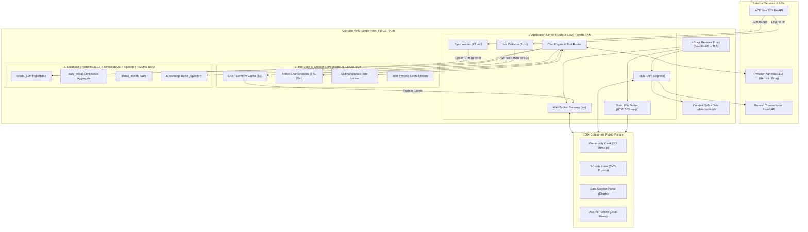
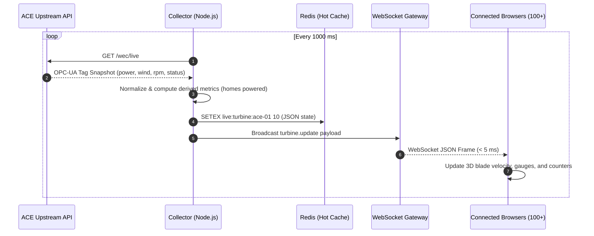
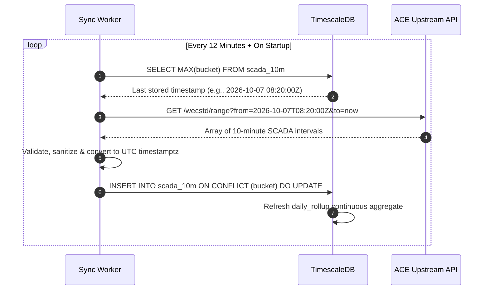
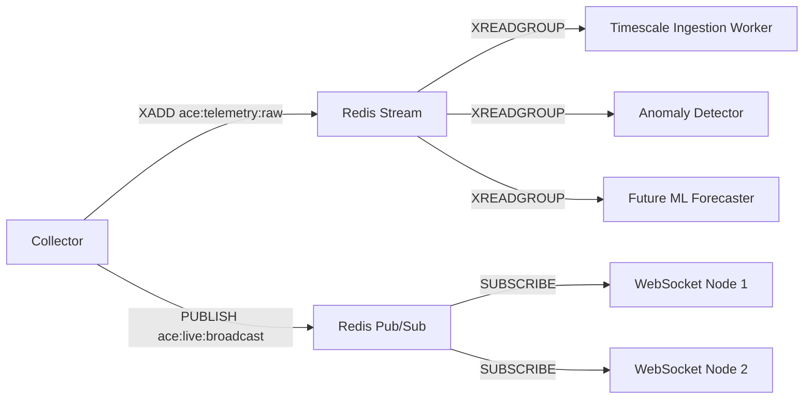
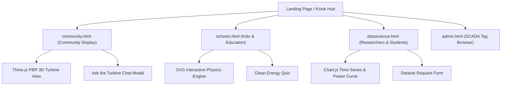
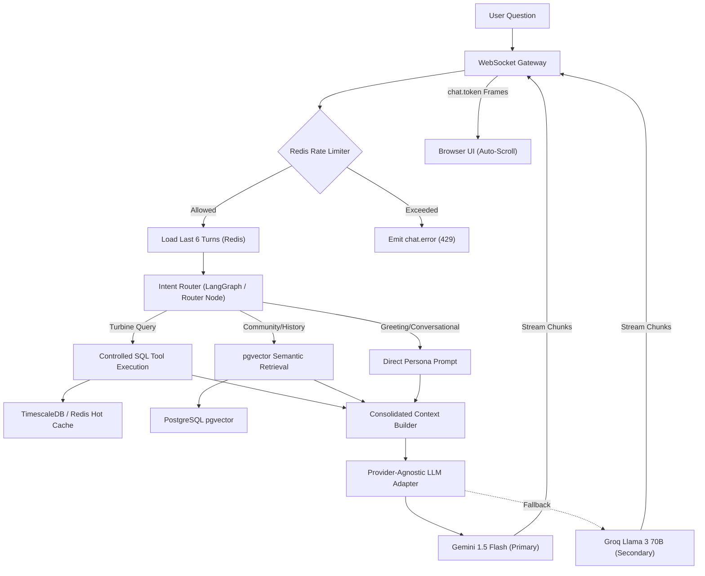
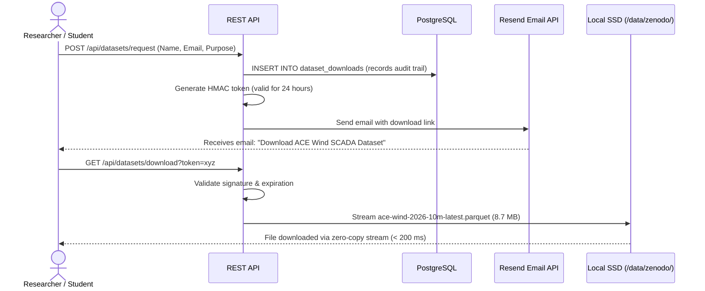
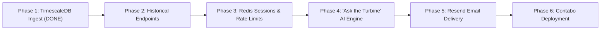

# ACE Wind Turbine Public Energy Platform — System Design

**Document Status:** Production Baseline / Implementation-Ready Architectural Specification  
**Deployment Target:** Single Contabo VPS (2–4 vCPU, 4–8 GB RAM) via Docker Compose  
**Primary Audiences:** Community kiosk visitors, local residents, primary/secondary school pupils, university engineering researchers  
**Core Principles:** Sub-second live telemetry, durability, single ingestion boundary, minimal operational complexity, bulletproof concurrency for 100+ simultaneous visitors

---

## Table of Contents
1. [Executive Summary](#1-executive-summary)
2. [Goals and Non-Goals](#2-goals-and-non-goals)
3. [System Architecture Overview](#3-system-architecture-overview)
4. [Data Flow & End-to-End Lifecycles](#4-data-flow--end-to-end-lifecycles)
5. [Event Streaming & Decoupling Architecture](#5-event-streaming--decoupling-architecture)
6. [Data Ingestion & Single Fetcher Boundary](#6-data-ingestion--single-fetcher-boundary)
7. [TimescaleDB Time-Series Data Model](#7-timescaledb-time-series-data-model)
8. [Redis Hot Cache & Session Architecture](#8-redis-hot-cache--session-architecture)
9. [WebSocket Protocol & Real-Time Broadcasting](#9-websocket-protocol--real-time-broadcasting)
10. [Public Frontend Architecture & Visualizations](#10-public-frontend-architecture--visualizations)
11. [3D Turbine Mechanics & Physics Simulation](#11-3d-turbine-mechanics--physics-simulation)
12. [Audience Personas & Storytelling Engines](#12-audience-personas--storytelling-engines)
13. ["Ask the Turbine" AI Conversational Architecture](#13-ask-the-turbine-ai-conversational-architecture)
14. [Multi-User Concurrency & Rate Limiting](#14-multi-user-concurrency--rate-limiting)
15. [Knowledge Retrieval (RAG via pgvector)](#15-knowledge-retrieval-rag-via-pgvector)
16. [Historical Dataset Storage & Email Delivery](#16-historical-dataset-storage--email-delivery)
17. [Fault Tolerance & Graceful Degradation](#17-fault-tolerance--graceful-degradation)
18. [Deployment & Container Orchestration (Contabo VPS)](#18-deployment--container-orchestration-contabo-vps)
19. [Security, Anonymous Sessions & Compliance](#19-security-anonymous-sessions--compliance)
20. [Public REST API & Developer Specification](#20-public-rest-api--developer-specification)
21. [Technology Matrix & Architectural Pruning Rationale](#21-technology-matrix--architectural-pruning-rationale)
22. [Locked Decisions & Implementation Roadmap](#22-locked-decisions--implementation-roadmap)

---

## 1. Executive Summary

The Ambition Community Energy (ACE) wind turbine is an Enercon E-115/E-126 3.5 MW, 4.2 MW turbine erected in Lawrence Weston, Bristol. It is the largest onshore community-owned wind turbine in England, generating 100% of its profits for local community development, fuel-poverty alleviation, and social projects.

This platform turns live OPC-UA SCADA telemetry and multi-year historical datasets into a public-facing, interactive digital experience and academic research repository.

### Key Capabilities
1. **Live Hoarding & Kiosk Display:** Sub-second streaming of real-time power (kW), wind speed (m/s), rotor RPM, blade pitch, and operational status, rendered in a 3D WebGL PBR turbine.
2. **Audience-Specific Personas:** Dedicated educational modes for children and schools (SVG physics game), university engineering and data science students (time-series exploration and power curves), and community residents (homes powered, revenue, and carbon offsets).
3. **"Ask the Turbine" AI Chatbot:** An interactive, conversational voice/text assistant grounded in live telemetry, historical SQL records, and local community knowledge via vector search.
4. **Automated Academic Dataset Delivery:** Automated delivery of verified 10-minute historical Parquet/CSV SCADA datasets to researchers via tokenized email links.

---

## 2. Goals and Non-Goals

### 2.1 Functional Goals
- **Single Ingestion Boundary:** Fetch live turbine data from the upstream ACE API once at 1 Hz, and 10-minute SCADA intervals once every 12 minutes. Never allow public visitors to directly trigger upstream API calls.
- **Durable Time-Series:** Ingest, index, and continuously aggregate all historical and real-time SCADA intervals into TimescaleDB.
- **Sub-Second Latency:** Broadcast 1 Hz updates to connected browsers with < 100 ms transmission latency via WebSockets.
- **Concurrent Multi-User Chat:** Support 100+ simultaneous visitors chatting with the turbine without exhausting external LLM rate limits or leaking conversational memory across visitors.
- **Grounding & Zero Hallucination:** Prevent AI hallucinations by enforcing parameterized database query tools rather than raw SQL generation.
- **Dataset Access:** Enable students and researchers to request full SCADA datasets via a lightweight web form with automated delivery via transactional email.

### 2.2 Non-Goals (What We Explicitly Avoid)
- **No Heavy Message Brokers (No Kafka):** The single-turbine data rate (1 msg/sec = ~0.5 KB/s) does not justify a 1.5 GB JVM Kafka cluster. In-memory event loops and Redis Streams provide identical decoupling with 98% less memory.
- **No Cloud Object Storage (No AWS S3 / MinIO):** The entire multi-year historical dataset is under 25 MB. Serving directly from the VPS NVMe SSD is instantaneous, free, and eliminates external cloud credentials.
- **No Heavy Frontend Framework Rewrite (No Next.js SSR):** The current vanilla HTML5, ES Modules, and Three.js frontend loads in < 200 ms and consumes 0 MB of server SSR memory.
- **No User Accounts or Logins:** The public display and website require no passwords or sign-ups; chat sessions are anonymous and ephemeral.
- **No Permanent Cross-Session Tracking (No Mem0):** Anonymous kiosk visitors do not persist permanent cross-session profiles, preventing context leakage between different visitors.

---

## 3. System Architecture Overview

The system is deployed on a single Contabo VPS running three tightly orchestrated Docker containers:



---

## 4. Data Flow & End-to-End Lifecycles

### 4.1 Live Telemetry Broadcast Lifecycle (1 Hz)
Every second, live power and rotational data flows from the turbine to every connected client display:



### 4.2 Historical SCADA Ingestion Lifecycle (Every 12 Minutes)
Continuous rollups and raw 10-minute intervals are preserved without duplicating records:



---

## 5. Event Streaming & Decoupling Architecture

### 5.1 Why Kafka is Excluded
The original draft proposed Apache Kafka with 6 topics. An audit showed that:
1. **Source Data Rate:** Exactly **1 message per second** (~500 bytes/sec).
2. **Resource Cost:** Running Kafka with JVM/KRaft requires **1.5 GB to 2.0 GB of RAM**. On a 4–8 GB VPS, this consumes 25%–50% of total memory.
3. **Audience Boundary:** End users connect to WebSockets, never Kafka.

### 5.2 The Lean Replacement: Redis Streams & Pub/Sub
Using the existing Redis container (using only 30 MB of RAM), we achieve complete architectural decoupling:



| Stream / Channel Key | Format | Producer | Consumer(s) | Retention / TTL |
| :--- | :--- | :--- | :--- | :--- |
| `ace:stream:telemetry` | Redis Stream (`XADD`) | Collector | TimescaleDB Writer, Anomaly Monitor | `MAXLEN ~ 10000` (~3 hours) |
| `ace:live:broadcast` | Redis Pub/Sub | Collector | WebSocket Gateway instances | Instant Fan-out |
| `live:turbine:ace-01` | String (JSON) | Collector | REST API, AI Tool Calling | `TTL = 10s` |

---

## 6. Data Ingestion & Single Fetcher Boundary

To prevent denial-of-service against the upstream ACE server:
1. **All Inbound Requests Blocked from ACE API:** Browsers, chatbots, and administrative dashboards read exclusively from Redis or TimescaleDB.
2. **Idempotent Ingestion Keys:** All SCADA 10-minute records are keyed on `(bucket)`, preventing duplicate rows.
3. **Resilience to Upstream Failures:** If the ACE API returns HTTP 500 or times out, the collector serves the last known state from Redis, flagged with `is_stale: true`, while the sync job retries with exponential backoff.

---

## 7. TimescaleDB Time-Series Data Model

The database runs in Docker as `ace_timescaledb` (`timescale/timescaledb:latest-pg16`).

### 7.1 Schema: `scada_10m` Hypertable
```sql
CREATE TABLE IF NOT EXISTS scada_10m (
    bucket               TIMESTAMPTZ NOT NULL,
    wind_speed_avg       NUMERIC(5,2),
    wind_speed_min       NUMERIC(5,2),
    wind_speed_max       NUMERIC(5,2),
    wind_speed_std       NUMERIC(5,2),
    power_avg            NUMERIC(6,1),
    power_min            NUMERIC(6,1),
    power_max            NUMERIC(6,1),
    energy_kwh           NUMERIC(7,1),
    reactive_power_avg   NUMERIC(6,1),
    wind_direction_avg   NUMERIC(5,1),
    ambient_temp_avg     NUMERIC(4,1),
    pitch_angle_avg      NUMERIC(4,1),
    rotor_rpm_avg        NUMERIC(4,1),
    sample_count         INTEGER DEFAULT 600,
    source               TEXT DEFAULT 'live_sync',
    CONSTRAINT scada_10m_pk PRIMARY KEY (bucket)
);

-- Convert to TimescaleDB Hypertable partitioned in 3-month chunks
SELECT create_hypertable('scada_10m', 'bucket', chunk_time_interval => INTERVAL '3 months', if_not_exists => TRUE);
```

### 7.2 Continuous Aggregate: `daily_rollup`
Pre-calculates daily metrics grouped by local **Europe/London** calendar day:
```sql
CREATE MATERIALIZED VIEW IF NOT EXISTS daily_rollup
WITH (timescaledb.continuous) AS
SELECT
    time_bucket('1 day', bucket, 'Europe/London')::date AS day,
    SUM(energy_kwh)                                     AS energy_total_kwh,
    ROUND(AVG(power_avg), 1)                            AS power_avg_kw,
    ROUND(MAX(power_max), 1)                            AS power_max_kw,
    ROUND(AVG(wind_speed_avg), 2)                       AS wind_speed_avg,
    ROUND(MAX(wind_speed_max), 2)                       AS wind_speed_max,
    ROUND(SUM(energy_kwh) / (3500.0 * 24.0) * 100.0, 2) AS capacity_factor,
    COUNT(*)                                            AS active_intervals
FROM scada_10m
GROUP BY 1;

-- Refresh policy: continuously refresh the last 7 days every 15 minutes
SELECT add_continuous_aggregate_policy('daily_rollup',
    start_offset => INTERVAL '7 days',
    end_offset   => INTERVAL '10 minutes',
    schedule_interval => INTERVAL '15 minutes');
```

### 7.3 Operational Status Events Table
```sql
CREATE TABLE IF NOT EXISTS status_events (
    id            BIGSERIAL PRIMARY KEY,
    observed_at   TIMESTAMPTZ NOT NULL,
    opc_node_id   TEXT NOT NULL,
    description   TEXT,
    status_type   TEXT, -- 'RUN', 'STOP', 'WARNING', 'ERROR'
    metadata      JSONB,
    CONSTRAINT status_events_unique UNIQUE (observed_at, opc_node_id)
);
CREATE INDEX IF NOT EXISTS idx_status_events_time ON status_events (observed_at DESC);
```

---

## 8. Redis Hot Cache & Session Architecture

Redis 7 runs as `ace_redis` on port 6379, configured with append-only file (AOF) persistence.

### Key Namespaces and TTL Policies
```text
live:turbine:ace-01              -> String (JSON, TTL: 10 seconds)
chat:session:{session_id}:meta    -> Hash (Created, LastActive, TurnCount, TTL: 20 min)
chat:session:{session_id}:history -> List (Last 6 JSON turns, TTL: 20 min)
ratelimit:session:{session_id}   -> Integer (Sliding window counter, TTL: 60s)
ratelimit:ip:{ip_address}        -> Integer (Sliding window counter, TTL: 600s)
cache:query:{query_hash}         -> String (Cached analytical JSON result, TTL: 300s)
```

---

## 9. WebSocket Protocol & Real-Time Broadcasting

The server exposes a single WebSocket endpoint at `ws://<domain>/ws`.

### 9.1 Handshake & Snapshot
Upon connection, the server immediately pushes a `turbine.snapshot` frame containing current status and 24-hour summary metrics:
```json
{
  "type": "turbine.snapshot",
  "data": {
    "timestamp": "2026-10-07T13:50:00.000Z",
    "power_kw": 2840.5,
    "wind_speed_ms": 9.4,
    "wind_direction_deg": 235.0,
    "rotor_rpm": 14.2,
    "pitch_deg": 3.2,
    "status": "RUNNING",
    "homes_powered": 2680,
    "energy_today_kwh": 34820.0,
    "is_live": true,
    "age_seconds": 1
  }
}
```

### 9.2 Periodic Broadcast (`turbine.update`)
Every second, connected clients receive an incremental diff:
```json
{
  "type": "turbine.update",
  "data": {
    "timestamp": "2026-10-07T13:50:01.000Z",
    "power_kw": 2855.0,
    "wind_speed_ms": 9.5,
    "rotor_rpm": 14.3
  }
}
```

### 9.3 Chat Streaming Events
Chat interactions use structured sub-protocols over the same WebSocket:
- `chat.send`: Client sends a prompt.
- `chat.started`: Server acknowledges and assigns stream ID.
- `chat.tool_call`: Server informs UI that a tool is being queried (e.g. `Fetching yesterday's power...`).
- `chat.token`: Server streams partial markdown text tokens.
- `chat.completed`: Final response delivered with token usage.
- `chat.error`: Rate limit or execution failure alert.

---

## 10. Public Frontend Architecture & Visualizations

The frontend is built on **Vanilla HTML5, CSS Grid, and ES Modules**, served statically by the Node.js Express server. It achieves **sub-200 ms initial paint** without build step complexity or SSR memory penalties.



---

## 11. 3D Turbine Mechanics & Physics Simulation

Implemented in [`public/community.html`](file:///c:/Users/Shashi%20kiran/Grinding/windmill/public/community.html) using Three.js WebGL:
1. **GLB Model (`ACE_Turbine.glb`):** Physically Based Rendering (PBR) metallic/roughness material shaders representing the 150m hub height and 115m rotor diameter.
2. **Rotational Physics:** Rotor blade rotation speed ($\omega$) dynamically maps to live SCADA RPM:
   $$\omega = \text{rotor\_rpm} \times \frac{2\pi}{60} \text{ rad/s}$$
3. **Wind Vector Particles:** Instanced buffer geometry renders 500 wind particle vectors travelling across the viewport, with speed proportional to `wind_speed_ms` and angle aligned to `wind_direction_deg`.
4. **Power Illumination:** Nacelle beacon and blade tip warning strobes pulse at frequencies mapped to instantaneous generation.

---

## 12. Audience Personas & Storytelling Engines

### 12.1 Community Display (`community.html`)
- **Focus:** Social and economic return to Lawrence Weston.
- **Equivalency Calculations:**
  - **Homes Powered:** $\text{Homes} = \frac{\text{Power (kW)}}{0.9 \text{ kW}}$ (average UK household draw).
  - **Bread Loaves Baked:** Energy equivalent based on 1.2 kWh per loaf.
  - **Electric Vehicle Miles:** Miles added per minute of generation based on 0.3 kWh/mile.
  - **Fuel Poverty Fund:** Cumulative revenue accrued to the Ambition Lawrence Weston charity fund.

### 12.2 Kids & Schools (`schools.html`)
- **Focus:** Interactive educational physics.
- **Features:** Drag-to-adjust wind slider, interactive Betz Limit explanation, animated turbine cutaway showing gearbox and generator, audio narration, and interactive quiz.

### 12.3 University & Data Science (`datascience.html`)
- **Focus:** Rigorous academic SCADA exploration.
- **Features:** 
  - Dual-axis time-series (Wind Speed vs. Power Output).
  - Empirical Power Curve scatter plots compared against the manufacturer Enercon E-115 theoretical curve.
  - Turbulence Intensity ($TI = \sigma / \mu$) calculations.
  - Direct dataset export forms.

---

## 13. "Ask the Turbine" AI Conversational Architecture

"Ask the Turbine" provides an interactive persona that speaks as the community wind turbine itself ("I am the Lawrence Weston turbine...").



### 13.1 Strict AI Tool Boundary
The LLM does not generate SQL. It only issues tool calls to these predefined functions:

```javascript
const turbineTools = {
  // Returns instantaneous live telemetry from Redis (0 ms latency)
  async getCurrentStatus() {
    return await redis.get('live:turbine:ace-01');
  },

  // Returns daily energy, peak power, and wind speed for a given date
  async getDailySummary({ date }) {
    const res = await db.query('SELECT * FROM daily_rollup WHERE day = $1', [date]);
    return res.rows[0];
  },

  // Returns aggregated 10m generation history for last 24h, 7d, or 30d
  async getPowerHistory({ range }) {
    const hours = range === '7d' ? 168 : range === '30d' ? 720 : 24;
    const res = await db.query(
      `SELECT bucket, power_avg, wind_speed_avg 
       FROM scada_10m 
       WHERE bucket >= NOW() - INTERVAL '${hours} hours' 
       ORDER BY bucket ASC`
    );
    return res.rows;
  },

  // Returns record highs (e.g. highest daily production, storm peaks)
  async getTurbineRecords() {
    const res = await db.query(
      `SELECT day, energy_total_kwh, wind_speed_max 
       FROM daily_rollup 
       ORDER BY energy_total_kwh DESC LIMIT 5`
    );
    return res.rows;
  }
};
```

---

## 14. Multi-User Concurrency & Rate Limiting

To support 100+ simultaneous chat visitors on a single VPS:

### 14.1 Ephemeral Session Isolation
- Every visitor generates a UUID `session_id`.
- The last 6 conversational turns are stored in Redis key `chat:session:{session_id}:history` with an automatic **20-minute sliding TTL**.
- When an anonymous user leaves, their conversation automatically cleans itself up in Redis, preventing memory leaks and avoiding permanent disk consumption.

### 14.2 Dual-Tier Sliding Window Rate Limiting
Implemented in Redis using atomic Lua scripts:
- **Per-Session Limit:** Max **6 messages per minute**. Prevents fast-looping automation.
- **Per-IP Limit:** Max **30 messages per 10 minutes**. Prevents a single device or bot from exhausting LLM quotas.
- If triggered, the server immediately returns a polite `chat.error`:
  > *"I am receiving a lot of questions right now! Please wait 30 seconds before asking again."*

### 14.3 Hot-State Query Deduplication
When 30 visitors simultaneously ask *"How much power are you generating right now?"*, the tool reads directly from Redis (`live:turbine:ace-01`), resolving in **0.1 ms** without querying PostgreSQL 30 times.

---

## 15. Knowledge Retrieval (RAG via pgvector)

Curated documentation (turbine engineering specs, Lawrence Weston local history, community benefit fund details, and school FAQ sheets) is indexed into PostgreSQL using the `vector` extension.

### 15.1 Schema
```sql
CREATE EXTENSION IF NOT EXISTS vector;

CREATE TABLE IF NOT EXISTS knowledge_documents (
    id         BIGSERIAL PRIMARY KEY,
    title      TEXT NOT NULL,
    category   TEXT NOT NULL, -- 'SPECS', 'HISTORY', 'COMMUNITY', 'EDUCATION'
    chunk_text TEXT NOT NULL,
    embedding  VECTOR(768),   -- Sized for standard embeddings (e.g. text-embedding-004)
    created_at TIMESTAMPTZ DEFAULT NOW()
);

-- Fast cosine similarity search index
CREATE INDEX IF NOT EXISTS idx_knowledge_embedding 
ON knowledge_documents USING hnsw (embedding vector_cosine_ops);
```

### 15.2 Retrieval Query
```sql
SELECT title, chunk_text, (1 - (embedding <=> $1)) AS similarity
FROM knowledge_documents
WHERE (1 - (embedding <=> $1)) > 0.65
ORDER BY similarity DESC
LIMIT 3;
```

---

## 16. Historical Dataset Storage & Email Delivery

### 16.1 Local Durable SSD Storage
- Multi-year Parquet and CSV archives are housed locally in `/data/zenodo/` (~16 MB total).
- No external S3 buckets, AWS IAM keys, or MinIO emulator containers are required.

### 16.2 Delivery Workflow


---

## 17. Fault Tolerance & Graceful Degradation

The platform is designed to degrade gracefully across various component failure modes:

| Failure Mode | Impact | Automated Recovery / Fallback Behavior |
| :--- | :--- | :--- |
| **ACE Upstream API Down** | No live data | WebSocket pushes last known state with `is_live: false` and `age_seconds`. UI displays a subtle "Telemetry Paused" badge. Replay mode activated for historical exploration. |
| **Redis Container Restarts** | Hot cache & sessions lost | App continues running; live state re-created on next 1-second poll. Active chat sessions reset without server crash. Historical data untouched. |
| **TimescaleDB Down** | Historical queries fail | Live 1 Hz broadcasting continues uninterrupted (runs in-memory via Redis/Node). Chat engine informs users that historical queries are temporarily unavailable. |
| **Primary LLM (Gemini) 429** | Chat requests rejected | LLM adapter catches 429 and immediately routes prompt to Groq (Llama 3 70B) in < 500 ms. |
| **Client Disconnects** | Stale WebSocket | Client UI initiates exponential backoff reconnection (`1s, 2s, 4s... max 30s`) and fetches fresh state on reconnect. |

---

## 18. Deployment & Container Orchestration (Contabo VPS)

The platform is managed via a single `docker-compose.yml` on a Contabo VPS running Ubuntu 22.04 LTS:

```yaml
version: '3.8'

services:
  timescaledb:
    image: timescale/timescaledb:latest-pg16
    container_name: ace_timescaledb
    restart: unless-stopped
    ports:
      - "127.0.0.1:5432:5432"
    environment:
      POSTGRES_USER: ace_user
      POSTGRES_PASSWORD: ${POSTGRES_PASSWORD:-ace_secure_password}
      POSTGRES_DB: ace_wind
    volumes:
      - timescaledb_data:/var/lib/postgresql/data
      - ./scripts/init_timescaledb.sql:/docker-entrypoint-initdb.d/init.sql:ro
    deploy:
      resources:
        limits:
          memory: 1024M

  redis:
    image: redis:7-alpine
    container_name: ace_redis
    restart: unless-stopped
    ports:
      - "127.0.0.1:6379:6379"
    volumes:
      - redis_data:/data
    command: redis-server --appendonly yes --maxmemory 128mb --maxmemory-policy allkeys-lru
    deploy:
      resources:
        limits:
          memory: 192M

  app:
    build: .
    container_name: ace_app
    restart: unless-stopped
    ports:
      - "127.0.0.1:4100:4100"
    environment:
      NODE_ENV: production
      PORT: 4100
      DATABASE_URL: postgres://ace_user:${POSTGRES_PASSWORD:-ace_secure_password}@timescaledb:5432/ace_wind
      REDIS_URL: redis://redis:6379
      GEMINI_API_KEY: ${GEMINI_API_KEY}
      GROQ_API_KEY: ${GROQ_API_KEY}
      RESEND_API_KEY: ${RESEND_API_KEY}
    volumes:
      - ./data:/app/data:ro
    depends_on:
      - timescaledb
      - redis
    deploy:
      resources:
        limits:
          memory: 384M

volumes:
  timescaledb_data:
  redis_data:
```

### Production NGINX Reverse Proxy
NGINX terminates TLS, compresses text assets, and manages WebSocket upgrades:
```nginx
server {
    server_name acewind.org www.acewind.org;
    listen 443 ssl http2;

    ssl_certificate /etc/letsencrypt/live/acewind.org/fullchain.pem;
    ssl_certificate_key /etc/letsencrypt/live/acewind.org/privkey.pem;

    location / {
        proxy_pass http://127.0.0.1:4100;
        proxy_http_version 1.1;
        proxy_set_header Upgrade $http_upgrade;
        proxy_set_header Connection "upgrade";
        proxy_set_header Host $host;
        proxy_set_header X-Real-IP $remote_addr;
        proxy_set_header X-Forwarded-For $proxy_add_x_forwarded_for;
        proxy_read_timeout 86400s;
    }
}
```

---

## 19. Security, Anonymous Sessions & Compliance

1. **Zero Personally Identifiable Information (PII) on Display:** Kiosks and website chats collect no names or emails.
2. **Download Email Minimal Retention:** When researchers request datasets, their email is stored solely in `dataset_downloads` for access auditing, never shared or marketed to.
3. **Internal Port Binding:** PostgreSQL and Redis ports are bound strictly to `127.0.0.1` and are never exposed directly to the public internet.
4. **Parameterized SQL Queries:** All SQL calls use parameterized prepared statements (`$1, $2`), preventing SQL injection attacks.

---

## 20. Public REST API & Developer Specification

The platform exposes read-only endpoints for developers and educational institutions:

| Method | Endpoint | Description | Cache Header |
| :--- | :--- | :--- | :--- |
| `GET` | `/health` | Health status of Node app, Redis, and TimescaleDB | `no-cache` |
| `GET` | `/api/live` | Current 1-second telemetry snapshot | `max-age=1` |
| `GET` | `/api/history` | Recent 10-minute intervals (`range=24h, 7d`) | `max-age=60` |
| `GET` | `/api/daily-rollup` | Daily continuous aggregate records | `max-age=300` |
| `GET` | `/api/records` | All-time generation records & peaks | `max-age=3600` |
| `POST` | `/api/datasets/request` | Submit researcher dataset download form | `no-cache` |
| `GET` | `/api/datasets/download` | Verify HMAC token & stream Parquet dataset | `private, no-transform` |

---

## 21. Technology Matrix & Architectural Pruning Rationale

| Layer | Original Proposal | Final Approved Architecture | Strategic Rationale |
| :--- | :--- | :--- | :--- |
| **Streaming** | Apache Kafka | Redis Pub/Sub + Streams | Saves 1.8 GB RAM; 1 msg/sec source rate makes Kafka an unnecessary operational burden. |
| **Dataset Storage** | AWS S3 / MinIO | Local NVMe SSD (`/data/zenodo/`) | Entire dataset is < 25 MB; local disk is faster, free, and needs no cloud credentials. |
| **Frontend** | Next.js / TypeScript | Vanilla HTML5 / ES Modules / Three.js | Eliminates SSR memory overhead (300MB); loads in < 200 ms with zero build friction. |
| **Chat Memory** | Mem0 SaaS | Ephemeral Redis TTL (20 min) | Anonymous public users must not have cross-session memory contamination or SaaS fees. |
| **Web Search** | Tavily API | Local `pgvector` RAG + SCADA Tools | Turbine domain questions are strictly local; eliminates 3s latency and per-query costs. |
| **Containers** | 10 Microservices | 3 Lean Containers | Drops total idle RAM from **~5.0 GB** down to **~600 MB** on a single Contabo VPS. |

---

## 22. Locked Decisions & Implementation Roadmap



### Phase Breakdown
1. **Phase 1 (Completed):** TimescaleDB hypertable (`scada_10m`), continuous aggregate (`daily_rollup`), 11,213 rows ingested, automated 12-minute live sync job running.
2. **Phase 2 (Immediate):** Expose analytical endpoints (`/api/history/compare`, `/api/history/records`, `/api/history/power-curve`).
3. **Phase 3:** Spin up Redis container; configure session TTL and sliding-window rate limiters.
4. **Phase 4:** Build "Ask the Turbine" streaming chat with tool router and `pgvector` knowledge search.
5. **Phase 5:** Add dataset request form with Resend transactional email links.
6. **Phase 6:** Configure NGINX reverse proxy and systemd service on Contabo VPS.
